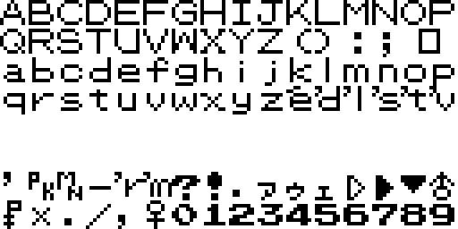
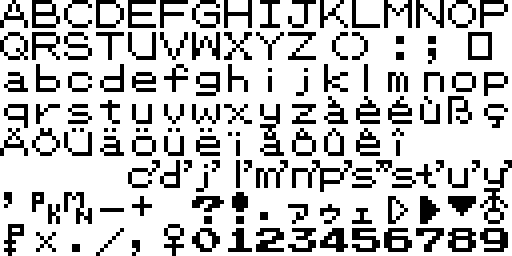

# Pokemon Red public graphics

This page is generated from the repository's verified `graphics/` tree. Japanese and Korean assets are listed before English and other official languages.

## Font

| Preview | File | Language | Size | SHA-256 |
| --- | --- | --- | --- | --- |
|  | [`graphics/font/main-font-jp.png`](graphics/font/main-font-jp.png) | Japanese | 512x256 | `7264ef108040d790...` |
|  | [`graphics/font/main-font-en.png`](graphics/font/main-font-en.png) | English | 512x256 | `ba6731b4173bc069...` |
|  | [`graphics/font/main-font-de.png`](graphics/font/main-font-de.png) | German | 512x256 | `cd47988ce551047a...` |
|  | [`graphics/font/main-font-fr.png`](graphics/font/main-font-fr.png) | French | 512x256 | `cd47988ce551047a...` |
|  | [`graphics/font/main-font-it.png`](graphics/font/main-font-it.png) | Italian | 512x256 | `2f4da34f88a5d169...` |
|  | [`graphics/font/main-font-es.png`](graphics/font/main-font-es.png) | Spanish | 512x256 | `2f4da34f88a5d169...` |

## Header

| Preview | File | Language | Size | SHA-256 |
| --- | --- | --- | --- | --- |
|  | [`graphics/header/nintendo-logo-en.png`](graphics/header/nintendo-logo-en.png) | English | 384x64 | `10e9a7189dad4bcc...` |
|  | [`graphics/header/nintendo-logo-de.png`](graphics/header/nintendo-logo-de.png) | German | 384x64 | `10e9a7189dad4bcc...` |
|  | [`graphics/header/nintendo-logo-fr.png`](graphics/header/nintendo-logo-fr.png) | French | 384x64 | `10e9a7189dad4bcc...` |
|  | [`graphics/header/nintendo-logo-it.png`](graphics/header/nintendo-logo-it.png) | Italian | 384x64 | `10e9a7189dad4bcc...` |
|  | [`graphics/header/nintendo-logo-es.png`](graphics/header/nintendo-logo-es.png) | Spanish | 384x64 | `10e9a7189dad4bcc...` |
|  | [`graphics/header/nintendo-logo.png`](graphics/header/nintendo-logo.png) | Unspecified | 384x64 | `10e9a7189dad4bcc...` |

## Pokemon

| Preview | File | Language | Size | SHA-256 |
| --- | --- | --- | --- | --- |
|  | [`graphics/pokemon/party-icons-atlas.png`](graphics/pokemon/party-icons-atlas.png) | Unspecified | 256x128 | `0de928b78122de91...` |
|  | [`graphics/pokemon/party-icons-source-atlas.png`](graphics/pokemon/party-icons-source-atlas.png) | Unspecified | 128x128 | `6ffe609e236f2a45...` |

Metadata sidecars:

- [`graphics/pokemon/party-icons-atlas.json`](graphics/pokemon/party-icons-atlas.json) — `7b49d88045ab5977...`

## Title

| Preview | File | Language | Size | SHA-256 |
| --- | --- | --- | --- | --- |
|  | [`graphics/title/version-jp.png`](graphics/title/version-jp.png) | Japanese | 320x32 | `fbfb3d0f98773929...` |
|  | [`graphics/title/version-en.png`](graphics/title/version-en.png) | English | 320x32 | `fbfb3d0f98773929...` |
|  | [`graphics/title/version-de.png`](graphics/title/version-de.png) | German | 320x32 | `cf6b3feef2beb81d...` |
|  | [`graphics/title/version-fr.png`](graphics/title/version-fr.png) | French | 320x32 | `383a2b485781d27d...` |
|  | [`graphics/title/version-it.png`](graphics/title/version-it.png) | Italian | 320x32 | `fbcea4b4d32e5d74...` |
|  | [`graphics/title/version-es.png`](graphics/title/version-es.png) | Spanish | 256x32 | `9c28047b5b5588fa...` |

Every entry is tied to at least one existing analysis or manifest record. Full hashes and provenance links are in `analysis/public-graphics-catalog.json`.
